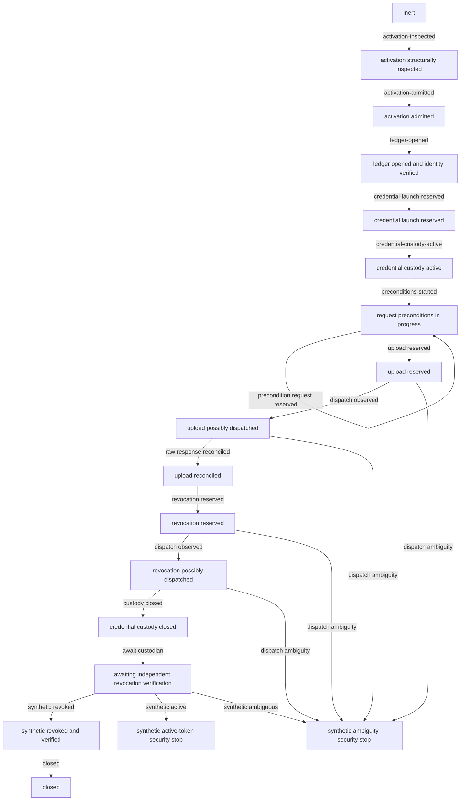

# Pure controller state machine

State protocol: `lachesis-m9b13k5-pure-controller-state/1`. Event protocol:
`lachesis-m9b13k5-controller-ledger-event/1`.

The model contains 22 states and 37 exact transition specifications. Eighteen
are workflow transitions, four are dispatch-ambiguity stops, and fifteen are
fail-closed quarantine transitions from every nonterminal source. Every other
state/event pair rejects.

The live terminal states `revoked_and_independently_verified`,
`active_token_security_stop`, and `ambiguity_security_stop` are schema-defined
but unreachable: no live authority or live custodian constructor exists.
Synthetic terminal language cannot be presented as live terminal language.

Each event contains the complete predecessor grammar: activation, request,
campaign, token, ledger implementation, namespace, store, artifact, prior
sequence/root, request index and cumulative counters, raw and canonical response
digests, ambiguity, dispatch boundary, monotonic observation, optional custodian
receipt, event identity, and new sequence/root. Terminal success cannot be
appended from a partial event.
